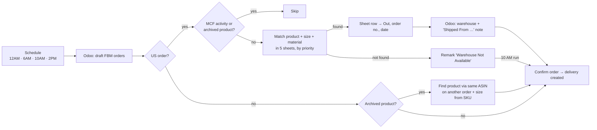

# Odoo × n8n Order Fulfilment Automation

An **n8n** automation that processes new **Amazon FBM orders in Odoo 18** end-to-end. It finds the matching item in five Google Sheets stock and return lists, reserves it, writes the dispatch details back to the sheet, sets the warehouse and shipping note in Odoo, and **confirms the order** so the delivery is created.

Before this, each order was handled by hand, one by one: open the order, look up the product in the sheets, mark the row "Out", type the dispatch details, change the warehouse, confirm. That process now runs 4 times a day with no one involved.

## What it does



### US orders: stock matching
- Checks the sheets in priority order: **Ameri Stock → Shipster Stock → Ameeri Return → Shipster Return → Faisal Return**.
- A match needs **product name + size + material** (sizes normalised: `Medium`→`M`, `X-Large`→`XL`, `XXL`→`2XL` …) with status **In**.
- **Oldest order first**, so it gets the last unit in stock. An order with several items only ships if *every* item is in the *same* warehouse.
- **On the sheet**, it writes status `Out`, the order number and today's date.
- **In Odoo**, it sets the warehouse and writes the dispatch note:
  - stock sheets: `Shipped From Ameri 10/22/2026 Bane Vest-Faux-Medium Box # 225` (SKU + box)
  - return sheets: `Shipped From LLC 10/22/2026 OLD ID S20230` (original return ID)
- Then it confirms the order through Odoo JSON-RPC (`action_confirm`).
- **Not in any sheet?** It adds the remark *Warehouse Not Available* once, keeps the order as a draft, and checks it again on the next runs. The **10 AM** run confirms any that are still unmatched.

### US orders: archived / unmapped products (separate workflow)
Amazon orders sometimes arrive with an archived placeholder product. For each archived line, the workflow:
1. Takes the line's **ASIN** and finds another order with the same ASIN that has a real product.
2. Picks the right **size variant from the Amazon SKU** (`…-Jacket-L` → Large).
3. Replaces the product on the line, keeping the original price, description, taxes and SKU.
4. If nothing is found, it adds the remark **Order Not Found** or **Product Not Found**.

It runs 10 minutes before the main workflow, so a fixed order ships in the same cycle.

### Other-country orders
For orders outside the US, archived products are fixed by ASIN the same way. Then the order is **confirmed directly**, with no warehouse check.

### Safety rules
| Rule | Why |
|---|---|
| Orders with an **MCF** activity are never touched | They're fulfilled through Amazon MCF |
| **Re-run safe**: rows already dispatched to an order are reused, not taken again | A run can be retried after a failure without double-booking stock |
| A failed confirm writes **"Confirm Failed - Odoo error: …"** on the order and the run continues | One bad order can't block the rest |
| "Already confirmed" responses are ignored | The team may confirm by hand at the same time |
| `testOrder` setting processes a single order | Safe testing on production data |

## Tech stack
- **n8n** (self-hosted): workflows, scheduling, Odoo and Google Sheets nodes, HTTP JSON-RPC
- **Odoo 18**: `sale.order`, `sale.order.line`, `product.product`, `mail.activity`, `stock.warehouse`
- **Google Sheets API**: five stock and return sheets
- **JavaScript**: the matching and planning logic (`src/`), unit-tested with Node's built-in test runner

## Repository layout
```
workflows/
  main-orders-workflow.json        # US stock matching + other-country branch + confirm
  archived-products-workflow.json  # replace archived products using the ASIN
src/
  plan-orders.js                   # stock matching / allocation logic (runs inside an n8n Code node)
  plan-fix-archived.js             # ASIN → product + size logic
test/                              # unit tests with synthetic data
```

## Setup
1. Import both files from `workflows/` into n8n (**Workflows → Import from file**).
2. Create an **Odoo** credential and a **Google Sheets OAuth2** credential in n8n, and select them on every Odoo and Google Sheets node.
3. In the **Config** node, set `odooUrl`, `odooDb`, `odooLogin`, `odooApiKey` (Odoo → Preferences → Account Security → New API Key) and the warehouse IDs. Replace `YOUR_GOOGLE_SHEET_ID` on the sheet nodes.
4. Test on one order: put an order number in `testOrder` and click **Execute workflow**. Then clear `testOrder` and activate the workflow.

## Running the tests
```bash
npm test
```

> All credentials, company identifiers and customer data have been removed from this repository. The test data is synthetic.
